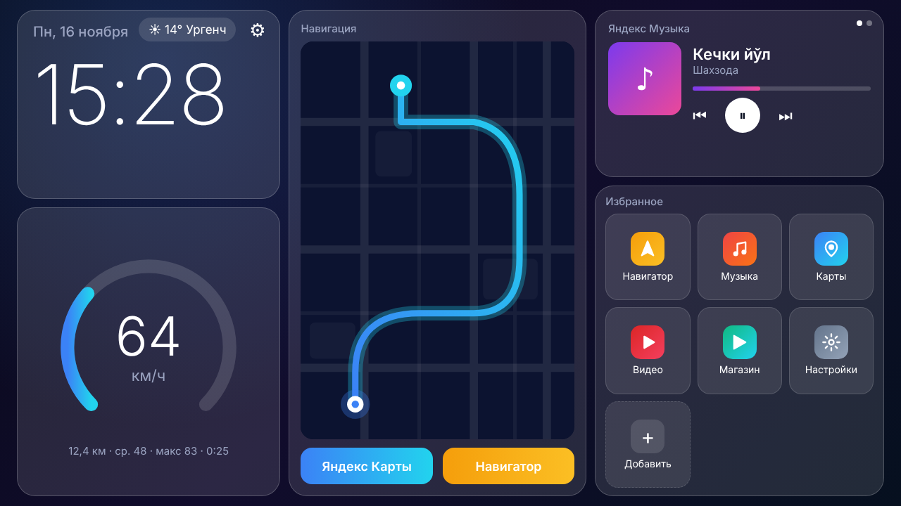
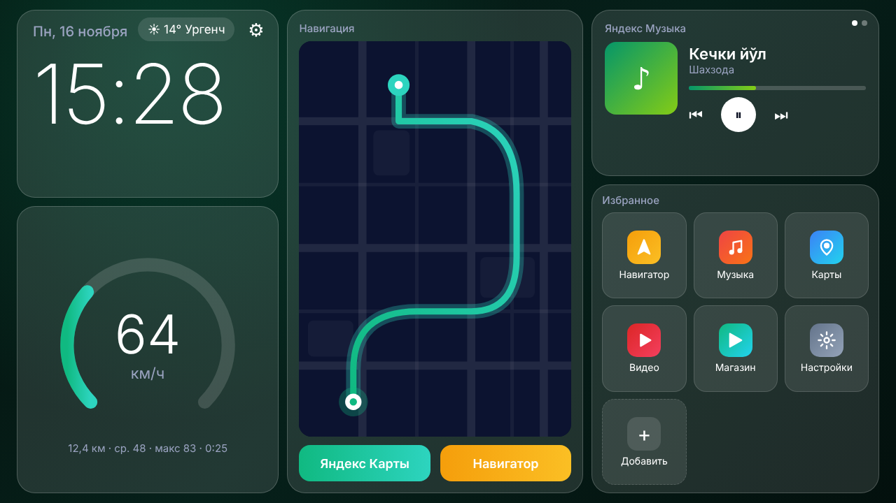
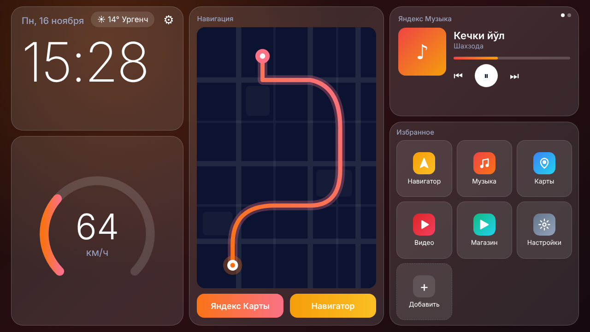
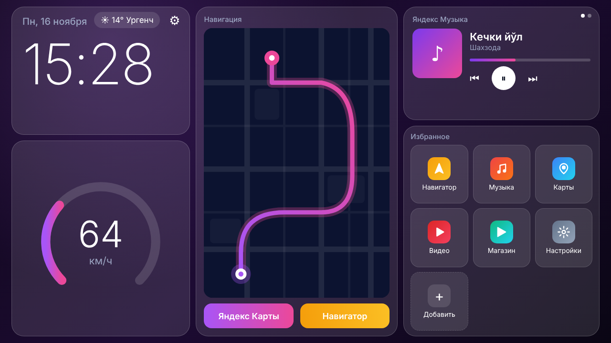
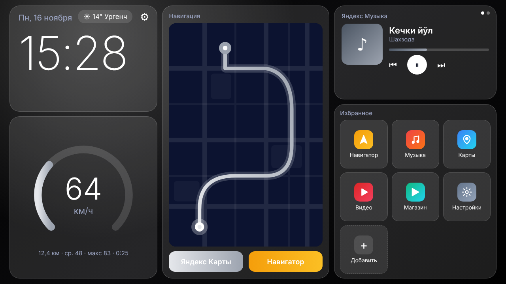
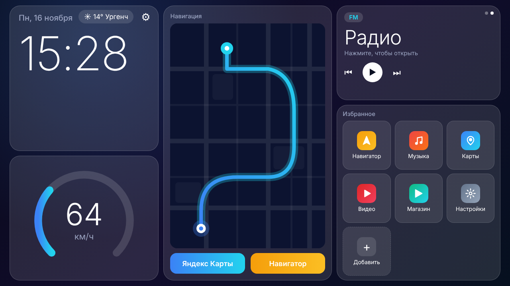

# Лёгкий лаунчер для автомагнитолы

Енгил ва чиройли **Android лаунчер** кучсиз автомагнитолалар учун (Android 7+; Android 13, 4/64 ГБ да синалган). Интерфейс русча. Стандарт лаунчер қотганда алмаштириш учун ясалган.

> Скриншотлар — дашборднинг дизайн макети (ранглар ва жойлашув ҳақиқий экранга мос).

## Имкониятлар

- **Соат, сана, об-ҳаво** (Open-Meteo, интернет керак)
- **GPS спидометр** — босилса Яндекс Карты очилади
- **Навигация карточкаси**: тирик Яндекс харита (ихтиёрий) ва «Яндекс Карты» / «Навигатор» тугмалари
- **Плеер ва радио** — свайп билан алмашади, ⏮ ⏯ ⏭ бошқаруви (Яндекс Музыка ва бошқа плеерлар)
- **Сафар ҳисоблагичи**: масофа, ўртача/макс тезлик, вақт (спидометр тагида; 1 сония босиб турилса нолга тушади)
- **Тезлик лимити** (лимитдан ошса қизил), созламада ўзгартирилади, стандарт 75 км/ч
- **Об-ҳаво GPS бўйича** — шаҳар ўзи алмашади
- **Ночью автоматик «Графит»** темаси, **автозапуск** (Яндекс Музыка / Навигатор), **«Очистить память»**, овоз ва Wi-Fi/Bluetooth/Экран тугмалари, **фон расми**
- **Избранное** — 3 устунли тез иловалар панели, ўзингиз танлайсиз
- **«Домой» тугмаси** дашборд ва барча иловалар орасида алмаштиради
- **5 та тема**: Ночь, Изумруд, Закат, Пурпур, Графит + шиша кучи созламаси
- **Ўзи янгиланади** — GitHub Releases орқали

## Темалар

| Изумруд | Закат |
|---|---|
|  |  |
| **Пурпур** | **Графит** |
|  |  |

Радио саҳифаси (свайп):

## Ўрнатиш

1. Магнитолада [**Releases**](../../releases/latest) саҳифасидан `FastLauncher.apk` ни юкланг ва очинг.
2. Сўралса, **«Неизвестные источники / Установка неизвестных приложений»** га рухсат беринг.
3. **Лаунчерни асосий қилинг**: *Созламалар → Приложения → Приложения по умолчанию → Главный экран (Домашнее приложение) → Лёгкий лаунчер*. (Бу бўлим магнитолада ҳар хил номланиши мумкин.)
4. Биринчи очилишда **геолокацияга** рухсат беринг (спидометр учун).
5. Плеер виджети ишлаши учун: **Созламалар → Уведомления → Доступ к уведомлениям** да «Лёгкий лаунчер» ни ёқинг.

## Янгилаш

Лаунчер ҳар 6 соатда янги версияни ўзи текширади. Қўлда: **⚙ → «Проверить обновления» → «Обновить»**.

## Созламалар (⚙)

- **Тема** — 5 та ранг схемаси
- **Сила стекла** — карточкаларнинг шаффофлиги
- **Живая карта** — тирик харитани ёқиш/ўчириш (магнитола қотса, ўчиринг: расмли карта қолади) ва MapKit API калити
- **Плееры** — қайси медиа плеерлар кўринаётгани (радио ишламаса, шу сатрни юборинг)

## Чекловлар

- Радио частотаси ва каналларини ўқиб бўлмайди: ⏮/⏭ тугмалари магнитоланинг радио иловаси медиа тугмаларига жавоб берсагина ишлайди.
- Ўртадаги харита Яндекс MapKit калити билан ишлайди; калитсиз ёки ўчирилганда чизилган карта кўринади.
- Яндекс иловаларининг ўзини лаунчер ичига жойлаб бўлмайди, улар алоҳида очилади.

## Йиғиш

Лойиҳа соф Java, AndroidX сиз (MapKit учун фақат зарур қисми), экран коддан қурилади. APK GitHub Actions орқали автоматик йиғилади (`.github/workflows/build.yml`), ҳар push да янги релиз чиқади.
